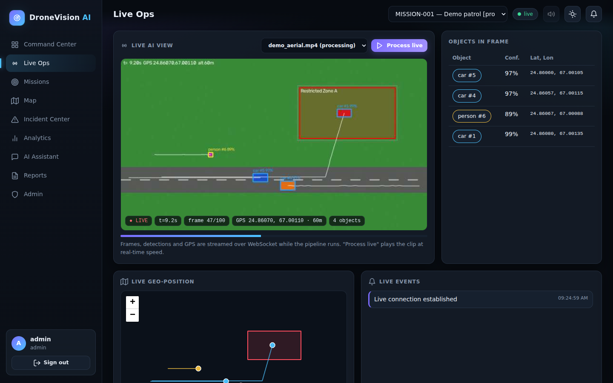
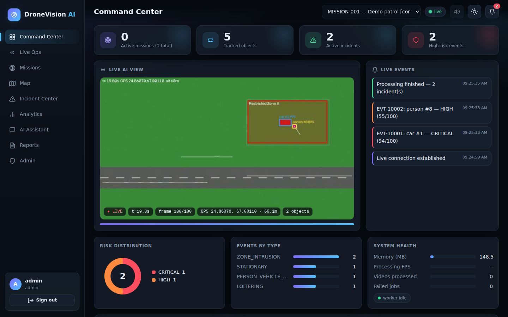
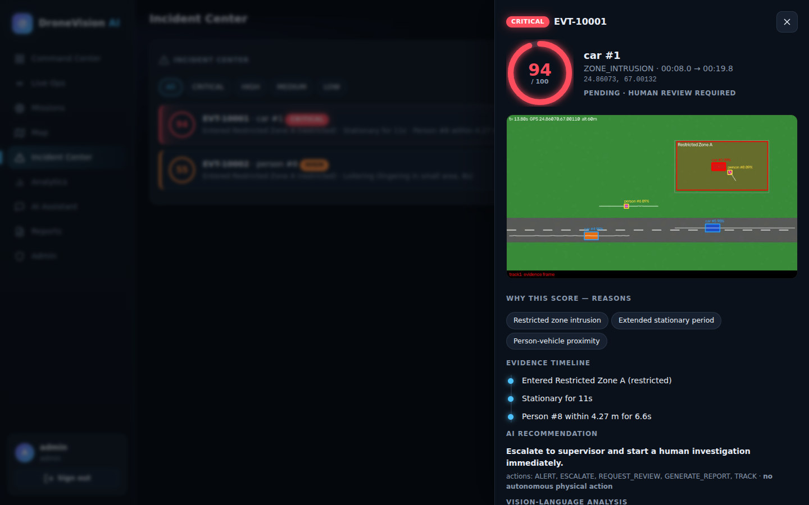
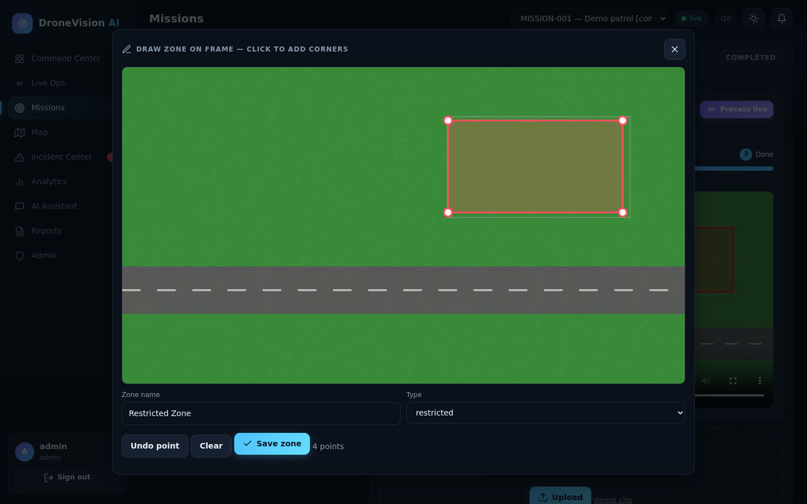
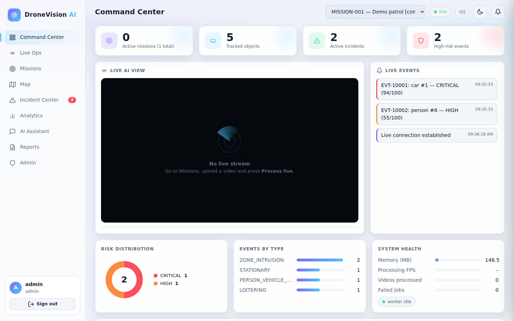
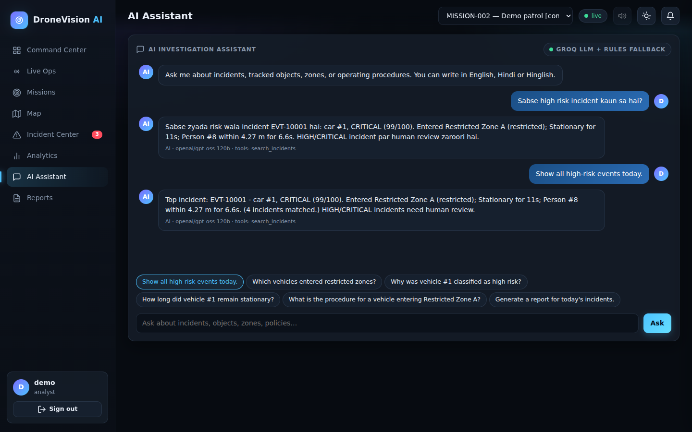
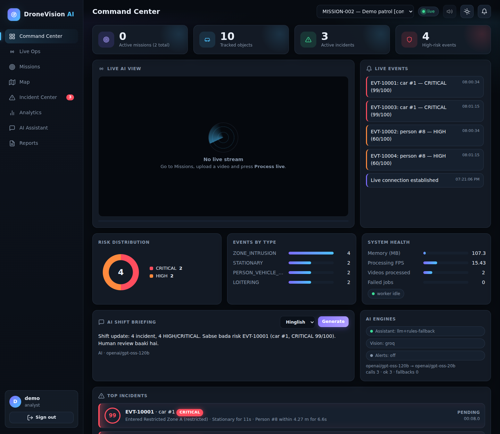

# DroneVision AI
Agentic geospatial intelligence for aerial video: detect -> track -> reason over time and space -> score risk ->
human review -> report. No physical drone needed (public/recorded video + simulated, deterministic GPS).

## Quick start
```bash
pip install -r requirements.txt
python scripts/make_demo_video.py                  # synthetic §42 scenario (3 vehicles, 2 people, restricted zone)
export SEED_PASSWORD='choose-a-password'           # users: admin / operator / analyst / viewer
uvicorn app.main:app --app-dir backend             # http://127.0.0.1:8000  (API docs: /docs)
python scripts/run_demo.py                         # optional: drives the whole scenario via the API
```
Dashboard: sign in as `operator` -> *Missions & Video* -> create a mission -> upload `datasets/demo_aerial.mp4`
(as `admin` first load the demo zone) -> Process -> *Incident Center* -> Approve/Dismiss -> *Reports*.

Expected result on the demo clip: Vehicle stops inside Restricted Zone A with a person approaching ->
`ZONE_INTRUSION + STATIONARY + PERSON_VEHICLE_PROXIMITY`, risk **94/100 CRITICAL**, evidence frame, VLM note,
recommendation "Escalate ... human investigation".

## Screenshots

<p align="center">
  
  <br><sub><b>Live Ops</b> - annotated frames, detections and GPS streamed in real time while the pipeline runs</sub>
</p>

<table>
  <tr>
    <td width="50%"><br><sub><b>Command Center</b> - KPIs, live view, event feed, risk charts</sub></td>
    <td width="50%"><br><sub><b>Incident drawer</b> - risk gauge, evidence frame, reasons, human review</sub></td>
  </tr>
  <tr>
    <td width="50%"><br><sub><b>Draw zones on the video frame</b> - converted to GeoJSON automatically</sub></td>
    <td width="50%"><br><sub><b>Light theme</b> - dark/light toggle</sub></td>
  </tr>
</table>

## AI features (Groq, free tier)
| | |
|---|---|
|  |  |
| **Assistant**: tool-calling over your data, answers in English / Hindi / Hinglish, with engine + tools shown | **Shift briefing + AI engines** |

* **LLM assistant** (Groq, OpenAI-compatible tool calling) - grounded: incident codes / object ids in an answer must exist in the tool results, else the answer is rejected and the rules engine answers.
* **Shift briefing**, **Explain this incident**, **vision analysis of evidence frames** (Groq vision model).
* **Always works without AI**: no key / outage / quota -> automatic fallback to the deterministic rules engine.
* **Alerts**: Telegram / Slack / Discord for HIGH & CRITICAL incidents. **Demo mode** with a read-only login for public links.
* Setup, free hosting and the `.com` question: see **[DEPLOY.md](DEPLOY.md)**.

## What's in the dashboard
Command Center (animated KPIs, live AI view, live event feed, risk/event charts, system health), **Live Ops** (annotated frames, detections and GPS
streamed over WebSocket while the pipeline runs; *Process live* plays a clip at real-time speed; objects table + moving geo-map), Missions
(upload, process, **draw zones directly on the video frame**), Map (zones, trajectories, incidents added live), Incident Center (severity filters,
risk gauge, evidence frame, timeline, human approve/dismiss/investigate), Analytics, tool-grounded AI Assistant, Reports (PDF/JSON/CSV),
Admin (users, audit log, model registry). Dark/light theme, optional sound alert on CRITICAL incidents. Prometheus metrics: `GET /api/v1/system/prometheus`.
Privacy mode: `BLUR_PERSONS=1`.

## Docker
```bash
cp .env.example .env        # set SEED_PASSWORD and JWT_SECRET (>=32 chars), optionally HOST_PORT
docker compose up --build   # http://localhost:8080
```
Real footage: set `INSTALL_YOLO=1` and `DETECTOR=yolo` in `.env`, then `docker compose up --build` (~1.5 GB extra, first build is slow).

## Real footage
`pip install -r requirements-yolo.txt` (CPU torch), then `DETECTOR=yolo`. Set the mission's start lat/lon/altitude/heading.
The built-in `blob` detector only works on the synthetic clip.

## Test & evaluate
```bash
cd backend && python -m pytest tests -q     # 88 tests, ~2 min
npm i jsdom && BASE=http://127.0.0.1:8000 SEED_PASSWORD=... node scripts/ui_test.mjs   # 75-76 UI checks (incl. real-time live view and AI features) against a running server
python scripts/evaluate.py                  # precision/recall/ID switches on the demo clip
```
See `docs/PROJECT_REQUIREMENTS.md` (status per requirement) and `docs/limitations.md` (what is still open).

## Safety
Monitoring and human-reviewed intelligence only. The Decision Agent selects software actions (log/alert/review/report/
escalate/track); `autonomous_physical_action` is always false, and HIGH/CRITICAL incidents require operator review.
